<!-- ANIMATED PROFILE -->

 

<table>
  <tr>
    <td width="50%" align="center" valign="top">
      
    </td>
    <td width="50%" align="center" valign="top">
      
    </td>
  </tr>
</table>

<!-- END ANIMATED PROFILE -->
# Shiva Sathvik

**Software engineering, security, and the systems underneath.**

Computer Science undergraduate · Class of 2027 · Hyderabad, India

 

I like building software and then looking past the surface: how the pieces fit together, what happens when something fails, and where a system can be made safer or simpler.

Most of my work is in **TypeScript and Python**. Outside of that, I'm learning more about **Linux internals, networking, and security engineering**.

[GitHub](https://github.com/shivasathvik44) · [Email](mailto:posanishiva6@gmail.com)

---

## `~/projects`

### 01 / [CyberShield](https://github.com/shivasathvik44/cybershield44)

**Threat intelligence and vulnerability analysis, in one place.**

A full-stack security operations project for exploring vulnerability data, checking IP reputation, and making threat information easier to work with.

- **Threat data:** CVE search, IP reputation checks, threat scoring, and intelligence feeds.
- **Access:** JWT authentication and role-based authorization.
- **Visibility:** An analytics dashboard for investigating the data.
- **Backend concerns:** Rate limiting and caching to make repeated requests more manageable.

`React` · `TypeScript` · `Node.js` · `Express` · `PostgreSQL`

**[Browse the repository →](https://github.com/shivasathvik44/cybershield44)**

### 02 / [AFOW](https://github.com/shivasathvik44/AFOW)

**A file organizer that lets you see what will happen before it happens.**

AFOW is a Python utility for sorting messy directories without making file operations feel like a gamble.

- **Organize:** Automatically categorize files in a directory.
- **Preview:** Use dry-run mode to inspect proposed changes first.
- **Recover:** Undo support and collision-safe handling to avoid accidental overwrites.
- **Use locally:** A lightweight Flask web interface.
- **Test:** Automated checks with Pytest.

`Python` · `Flask` · `Pytest`

**[Browse the repository →](https://github.com/shivasathvik44/AFOW)**

---

## `~/toolbox`

The tools I use or work with, grouped by where they fit rather than by logo.

| Area | Tools |
| --- | --- |
| **Languages** | Python, TypeScript, JavaScript, C, C++, Bash |
| **Web & APIs** | React, Node.js, Express, Flask, REST APIs |
| **Data & UI** | PostgreSQL, Tailwind CSS |
| **Systems & workflow** | Linux, Docker, Git, GitHub, Pytest |

### Areas I keep coming back to

`Threat intelligence` · `Vulnerability analysis` · `Authentication` · `Access control` · `Networking` · `Filesystems`

---

## `~/currently-exploring`

I'm interested in what happens below the application layer. Right now, that means spending more time with:

- **Linux internals:** how the operating system manages processes, files, and resources.
- **Networking & network security:** understanding how systems communicate and where trust breaks down.
- **Systems programming:** getting closer to the interfaces and constraints that higher-level tools abstract away.
- **eBPF & kernel observability:** learning how to inspect system behavior at a lower level.
- **Security tooling:** turning security concepts into utilities I can build, test, and understand.

---

I'm usually learning something by building it. If you want to talk about a project, security, or systems, [send me an email](mailto:posanishiva6@gmail.com).
